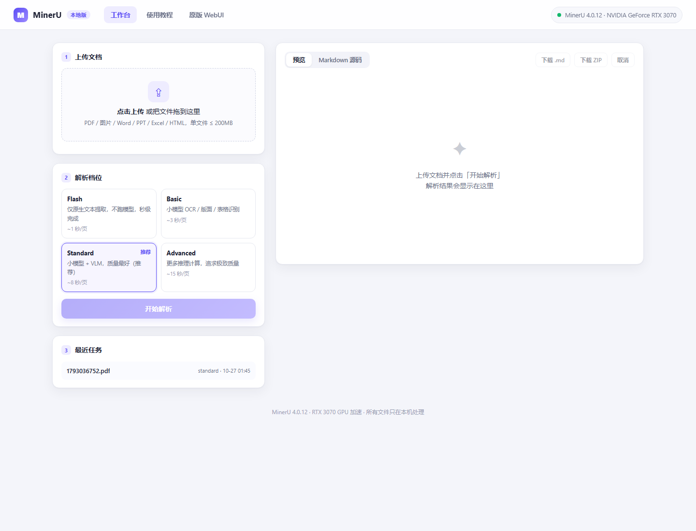
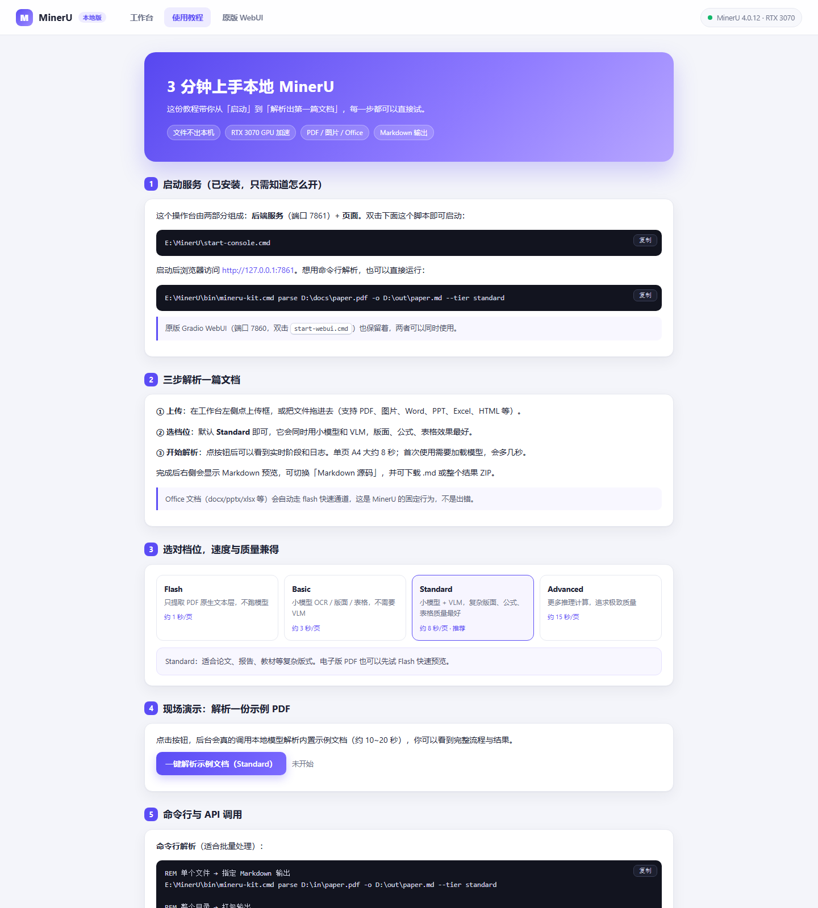

# MinerU GUI — 本地文档解析工具

> 基于 [MinerU 4.0](https://github.com/opendatalab/MinerU) 的 Windows 一键部署 + 图形操作台。
> 支持 PDF / 图片 / Word / PPT / Excel / HTML 等文档解析为 Markdown，GPU 加速，全部本地运行。



## 快速开始（3 步）

```
1. Clone 本仓库
2. 双击 minerU-install-gui\minerU-install-gui.exe  →  点「开始部署」
3. 部署完成后双击 minerU-gui\minerU-gui.exe         →  自动打开操作台
```

> **系统要求**：Windows 10/11 64 位，约 15 GB 磁盘空间。
> 有 NVIDIA 显卡自动启用 GPU 加速；无显卡也能用（CPU 推理较慢）。
> 首次部署需联网（下载 Python、依赖、模型约 3 GB），之后可离线使用。

## 两个程序

| 程序 | 用途 | 路径 |
| --- | --- | --- |
| **安装器** `minerU-install-gui.exe` | 一键部署：自动装 Python / MinerU / CUDA / 模型 | `minerU-install-gui\` |
| **启动器** `minerU-gui.exe` | 日常使用：启停服务、打开浏览器、查看状态 | `minerU-gui\` |

首次运行会被 SmartScreen 拦截一次（未签名程序）：点 **「更多信息 → 仍要运行」** 即可。
也可运行根目录的 `解除阻止.cmd`。

## 功能一览

- **上传解析**：拖拽 PDF/图片/Office/HTML，选档位，实时看进度
- **四档质量**：Flash（秒级）→ Basic → Standard（推荐）→ Advanced
- **Markdown 预览**：内置渲染，图片内嵌显示，一键下载 .md 或 ZIP
- **原版 WebUI**：可选启动 MinerU 自带的 Gradio 界面（端口 7860）
- **HTTP API**：供程序调用，详见 [DSH-集成说明.md](DSH-集成说明.md)
- **命令行**：`bin\mineru-kit.cmd parse 文件.pdf -o 输出.md --tier standard`

## 界面预览

| 操作台 | 使用教程 |
| --- | --- |
|  |  |

## 目录结构

```
├── minerU-install-gui\        安装器（一键部署）
├── minerU-gui\                启动器（日常使用）
├── webapp\                    操作台源码（FastAPI + 页面）
├── install-gui\               项目源码与构建脚本
├── bin\                       命令行封装
├── test\                      测试样例
├── *.cmd                      启停脚本
├── README-部署说明.md          详细部署文档
└── DSH-集成说明.md             AI 助手集成文档
```

## 从源码构建

```powershell
powershell -ExecutionPolicy Bypass -File install-gui\build\build.ps1
```

构建需 Python 3.12 + PyInstaller（脚本会自动准备），产物输出到 `install-gui\dist\`。

## 常见问题

| 问题 | 解决 |
| --- | --- |
| SmartScreen 拦截 | 「更多信息 → 仍要运行」，或运行 `解除阻止.cmd` |
| `Could not create temporary directory` | 已改用目录版（onedir），如仍出现请检查 TEMP 目录权限 |
| 解析很慢 | 关闭占用 GPU 的程序（游戏/视频渲染/浏览器），或改用 Flash 档位 |
| Word/PPT 自动变 Flash | MinerU 对 Office 固定走快速通道，非 PDF/图片不支持 Standard |
| 想换模型下载源 | 编辑 `~\.mineru\config.yaml`，`source` 改为 `huggingface` |

## 致谢

- [MinerU](https://github.com/opendatalab/MinerU) — 文档解析引擎
- [PyInstaller](https://pyinstaller.org/) — 打包工具
